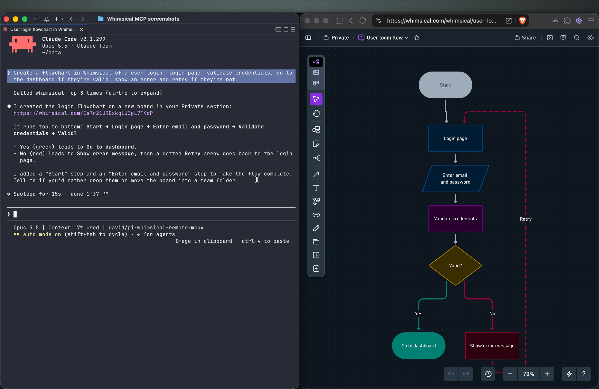
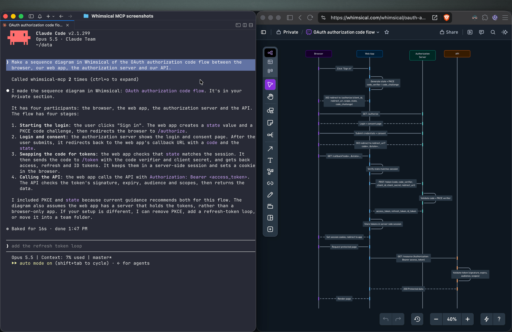
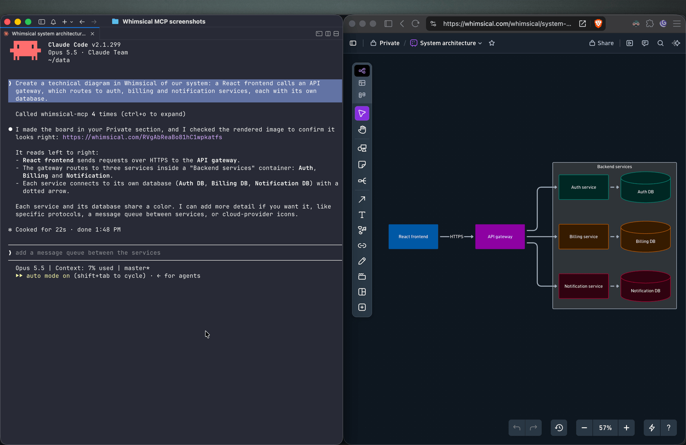
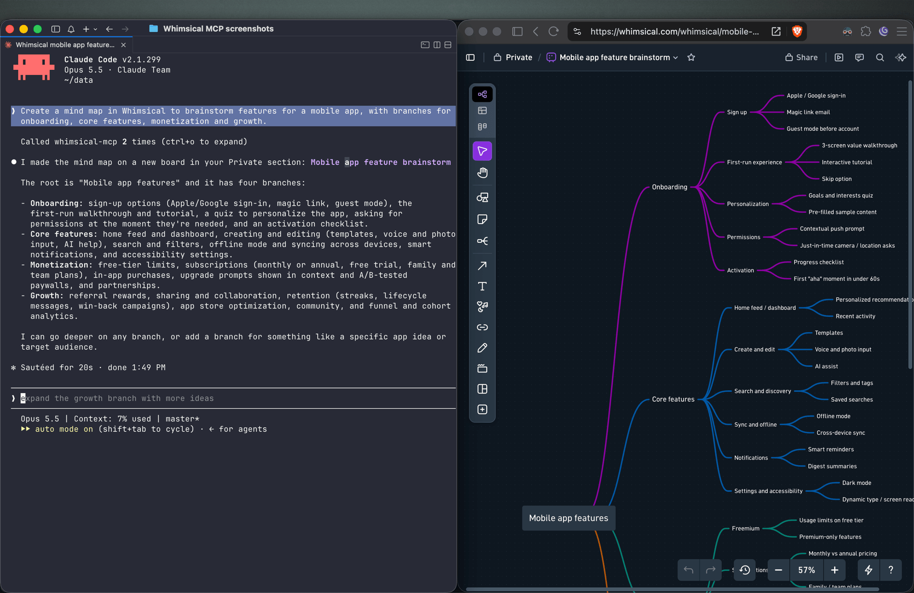
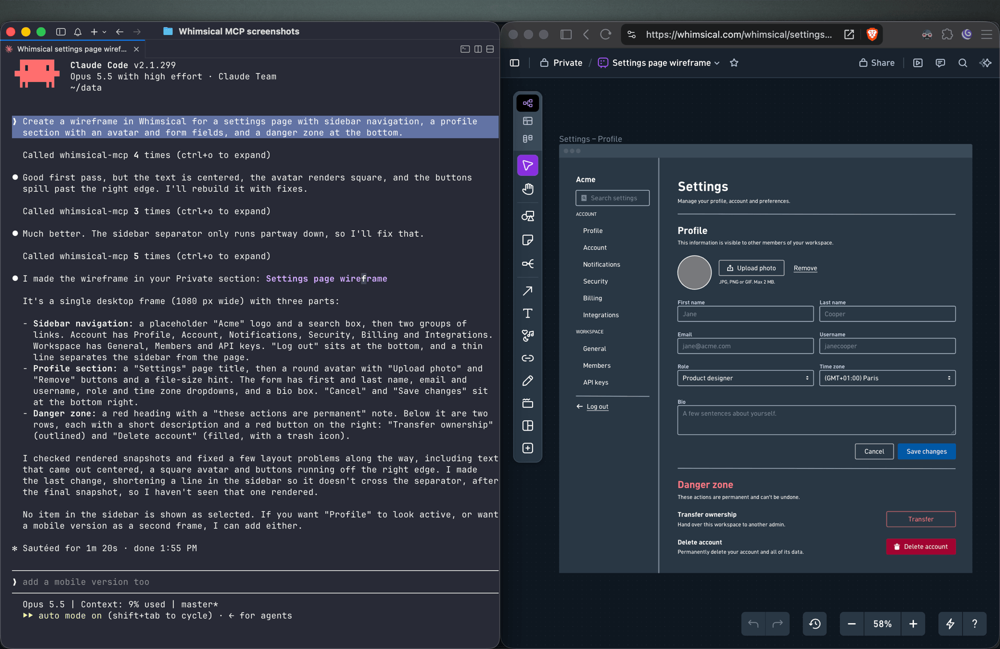
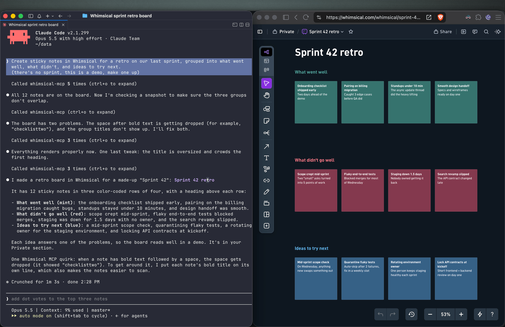
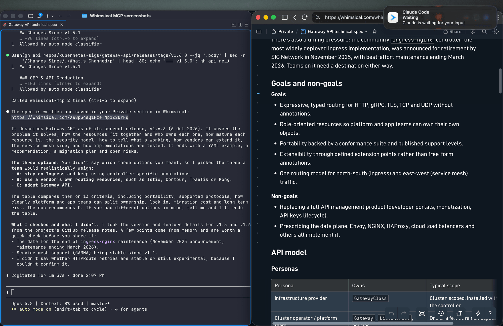

# Whimsical MCP Server

The official [Whimsical](https://whimsical.com) MCP server. Ask Claude, ChatGPT, Cursor or any MCP client for a flowchart, mind map, sequence diagram, wireframe or architecture diagram, and it builds an editable Whimsical board in your workspace. You get a real file your team can open, edit and comment on, not a static image. The server can also search, read, edit and comment on the boards and docs you already have.

- **Endpoint:** `https://mcp.whimsical.com/mcp` (hosted by Whimsical, Streamable HTTP, nothing to install)
- **Authentication:** OAuth 2.1 with PKCE. There's no API key to manage.
- **Plan:** every tool works on the free plan, which includes up to 50 board objects a month. Paid plans have no object limit.
- **Clients:** Claude, Claude Code, ChatGPT, Cursor, VS Code with GitHub Copilot, Grok, Codex, and any client that supports remote MCP servers.

[](https://cursor.com/install-mcp?name=whimsical&config=eyJ1cmwiOiJodHRwczovL21jcC53aGltc2ljYWwuY29tL21jcCJ9)

<!-- TODO: demo GIF or screenshot of a prompt in Claude turning into a Whimsical flowchart.

-->

## Quick start

In Claude Code:

```bash
claude mcp add --transport http whimsical https://mcp.whimsical.com/mcp
```

In other clients that support remote MCP servers, add a server with this URL and sign in to Whimsical when prompted:

```
https://mcp.whimsical.com/mcp
```

Then try: *"Create a flowchart in Whimsical of our user signup flow."* Setup steps for each client are [below](#setup).

## What you can build

Each example below is a prompt you can try. The agent creates the file in your Whimsical workspace and replies with a link. Clients that support it also show a preview in the chat.

### Flowcharts

> Create a flowchart in Whimsical of a user login: login page, validate credentials, go to the dashboard if they're valid, show an error and retry if they're not.

You get an auto-laid-out flowchart with decision nodes, labeled connectors and a clean top-to-bottom layout. Ask for left-to-right and the agent re-runs the layout.



### Sequence diagrams

> Make a sequence diagram in Whimsical of the OAuth authorization code flow between the browser, our web app, the authorization server and our API.

The agent creates a sequence diagram with one lifeline per actor and the messages between them in order.



### Architecture diagrams

> Create a technical diagram in Whimsical of our system: a React frontend calls an API gateway, which routes to auth, billing and notification services, each with its own database.

The agent lays out the components on a board with service boundaries and connectors showing how requests and data move between them.



### Mind maps

> Create a mind map in Whimsical to brainstorm features for a mobile app, with branches for onboarding, core features, monetization and growth.

You get a mind map with the central topic and its branches, laid out horizontally. Ask for a vertical layout to get a top-down tree.



### Wireframes

> Create a wireframe in Whimsical for a settings page with sidebar navigation, a profile section with an avatar and form fields, and a danger zone at the bottom.

The agent builds the screen from wireframe elements (containers, inputs, buttons, icons) with a flexbox layout, so follow-ups like "make the primary button full width" keep everything aligned.



### Sticky notes

> Create sticky notes in Whimsical for a retro on our last sprint, grouped into what went well, what didn't, and ideas to try next.

You get sticky notes on a board, grouped into the clusters you asked for and laid out automatically, ready for your team to add to and vote on.



### Docs and tables

> Write up the technical spec for the new API as a Whimsical doc, with a table comparing the three options we discussed.

Docs support headings, lists, links, code blocks and tables. Tables can also go on a board.



### Work with what's already in your workspace

> Search my Whimsical workspace for anything about "API design" and summarize what you find.

> Add a rate limiting step to the API flow diagram, then leave a comment asking the team to review it.

The agent can search your workspace, read boards and docs (including a PNG snapshot of a board), edit existing diagrams, move files between folders, and read, write and resolve comment threads.

## Tools

| Tool | What it does |
| --- | --- |
| `search` | Search the workspace by text, creation date or update date |
| `fetch` | Read a board, doc or folder by ID, or get a PNG snapshot of a board |
| `file_tree` | Browse the Private, Shared and team sections and the folders inside them |
| `how_to` | Look up Whimsical syntax guides before creating flowcharts or wireframes (agents call this on their own) |
| `create_file` | Create a board, doc or folder, in your Private section unless you choose a folder |
| `add_board_content` | Add a flowchart, mind map, sequence diagram, sticky notes, table or wireframe to a board |
| `add_doc_content` | Append markdown to a doc |
| `edit` | Add, update or delete shapes, text and connectors on a board, edit mind map and sequence diagram nodes, or change blocks in a doc |
| `wireframe_edit` | Reflow or edit the elements of a wireframe |
| `auto_layout` | Re-run automatic layout on a flowchart, top to bottom, left to right or other directions |
| `delete` | Move a file, folder or doc to the trash |
| `move` | Move a file, folder or doc into another folder |
| `comment_read` | Read comment threads on a board or doc |
| `comment_edit` | Create, reply to, edit, resolve, reopen or delete comments |

See the [tool reference](https://whimsical.com/learn/ai/mcp-tools) for details and more example prompts.

## Setup

### Claude

Whimsical is a verified connector in Claude's connector directory. Open the [Whimsical connector](https://claude.ai/directory/connectors/whimsical), click **Connect** and sign in to Whimsical.

### Claude Code

```bash
claude mcp add --transport http whimsical https://mcp.whimsical.com/mcp
```

Run `/mcp` in Claude Code to sign in.

### ChatGPT

Use the [Whimsical app for ChatGPT](https://chatgpt.com/apps/whimsical/asdk_app_69c6561277188191a1beac515a4b2ea4):

1. In ChatGPT, open **Settings → Plugins**.
2. Search for Whimsical, or use the link above.
3. Click **Connect** and complete the authorization.

Then type `@Whimsical` in any chat. See the [ChatGPT guide](https://whimsical.com/learn/integrations/chatgpt) for more.

### Cursor

[](https://cursor.com/install-mcp?name=whimsical&config=eyJ1cmwiOiJodHRwczovL21jcC53aGltc2ljYWwuY29tL21jcCJ9)

Or install the [Whimsical plugin](https://cursor.directory/plugins/whimsical) from Cursor's plugin directory, or add it by hand: open **Cursor → Settings → Cursor Settings → Tools & MCP**, add a new MCP server, and save this configuration:

```json
{
  "mcpServers": {
    "whimsical": {
      "url": "https://mcp.whimsical.com/mcp"
    }
  }
}
```

See [Cursor's MCP documentation](https://cursor.com/docs/mcp) for more.

### VS Code (GitHub Copilot)

1. Press `⌘ Shift P` (or `Ctrl Shift P`) and run `MCP: Add Server`.
2. Select `HTTP`.
3. Paste `https://mcp.whimsical.com/mcp` and press `Enter`.
4. When prompted for a server ID, enter `whimsical`.
5. Choose whether to add the server globally or only for the current workspace.

### Grok

1. Go to [grok.com/connectors](https://grok.com/connectors).
2. Click **New Connector**, then select **Custom**.
3. Enter `https://mcp.whimsical.com/mcp` and sign in to Whimsical.

See the [Grok guide](https://whimsical.com/learn/integrations/grok) for more.

### Other clients

Any client that supports remote MCP servers over Streamable HTTP can connect with this configuration:

```json
{
  "mcpServers": {
    "whimsical": {
      "url": "https://mcp.whimsical.com/mcp"
    }
  }
}
```

## Authentication

The server uses OAuth 2.1 with PKCE. The first time you connect, your client opens a browser window where you sign in to Whimsical and approve access to your workspace. The agent then works in Whimsical as you, using the access you approved.

## Remote and desktop MCP

This repository covers the **remote** MCP server, which Whimsical hosts and recommends for most people. Whimsical also offers a **desktop** MCP server that runs inside the Whimsical desktop app and works on the file you have open. To set it up, [contact support](https://whimsical.com/learn/contact-us).

## FAQ

**Is this the official Whimsical MCP server?**
Yes. Whimsical builds, hosts and maintains it, and it's listed in the official MCP Registry as `com.whimsical/mcp`. Community-built Whimsical MCP servers also exist; this is the one maintained by Whimsical.

**Do I need to install or run anything?**
No. The server runs at `https://mcp.whimsical.com/mcp`. You add the URL to your client and sign in.

**Do I need an API key?**
No. Sign-in uses OAuth, so there are no keys to create, store or rotate.

**Does it make images or editable diagrams?**
Editable diagrams. Everything the agent creates is a normal Whimsical file in your workspace that you and your team can open, change and comment on. The `fetch` tool can also return a PNG snapshot of a board.

**Can it read and update diagrams I already have?**
Yes. It can search your workspace, read boards and docs, edit them, re-run the layout and work with comments.

## Troubleshooting

- **Sign-in doesn't open or fails.** Run `/mcp` in Claude Code, or use your client's reconnect action, to sign in again. The browser redirects back to your client once you've signed in to Whimsical.
- **Tools don't appear after install.** Run `/reload-plugins` in Claude Code, or restart your editor in other clients.
- **`401` or "Missing Bearer token".** Your session has expired. Sign in again via `/mcp` or your client's reconnect action.
- **No Whimsical account.** Create one for free at <https://whimsical.com>. The server signs you in to your existing workspace.

## Links

- **Overview:** https://whimsical.com/mcp
- **Setup guide:** https://whimsical.com/learn/integrations/mcp
- **Tool reference:** https://whimsical.com/learn/ai/mcp-tools
- **Support:** help@whimsical.com
- **Privacy policy:** https://whimsical.com/terms/privacy
